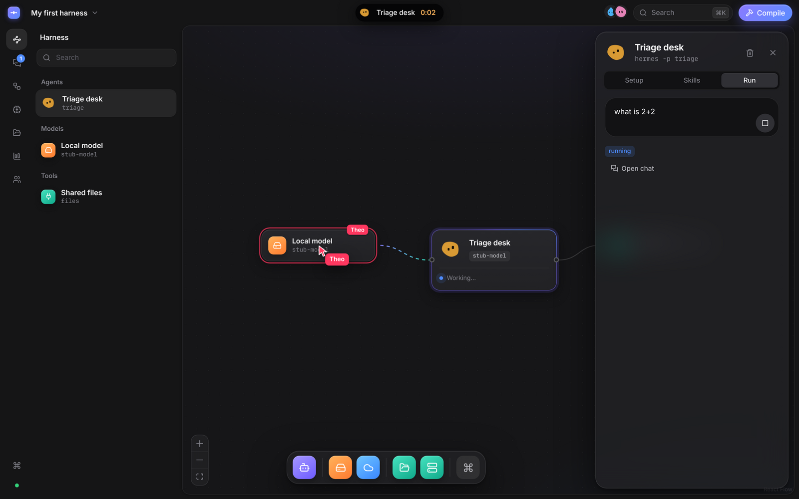
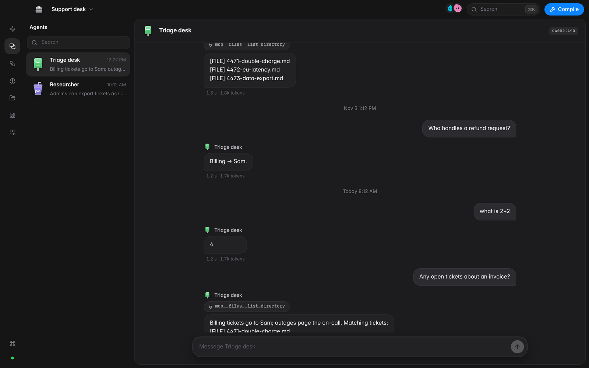
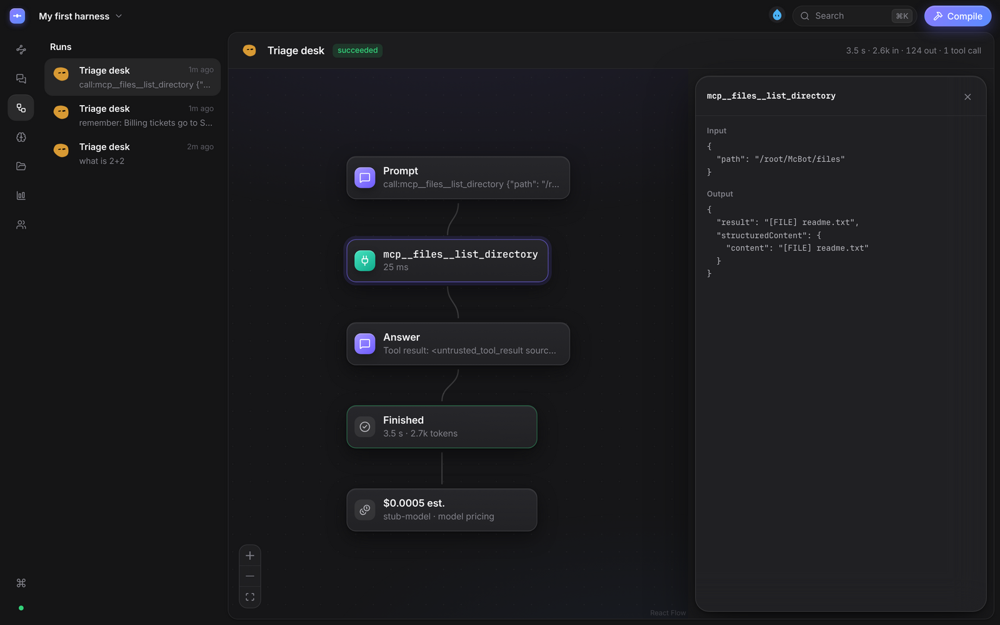
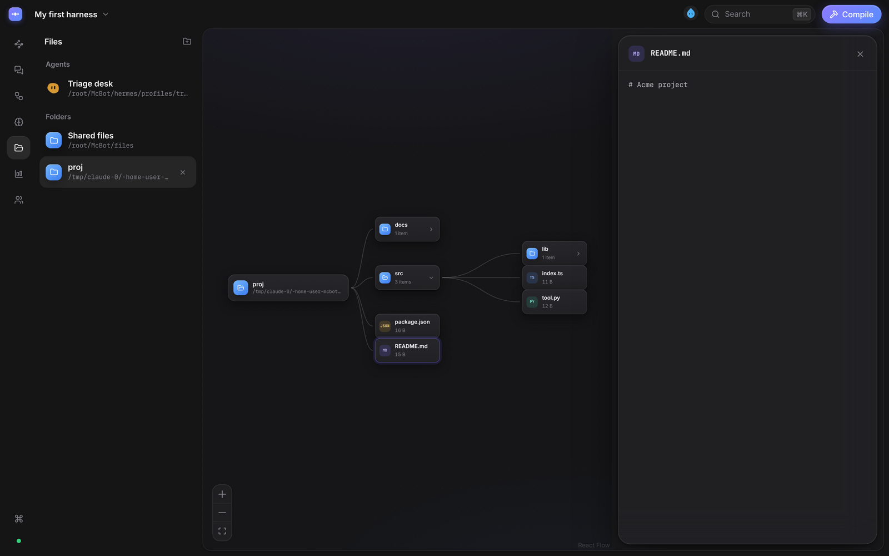
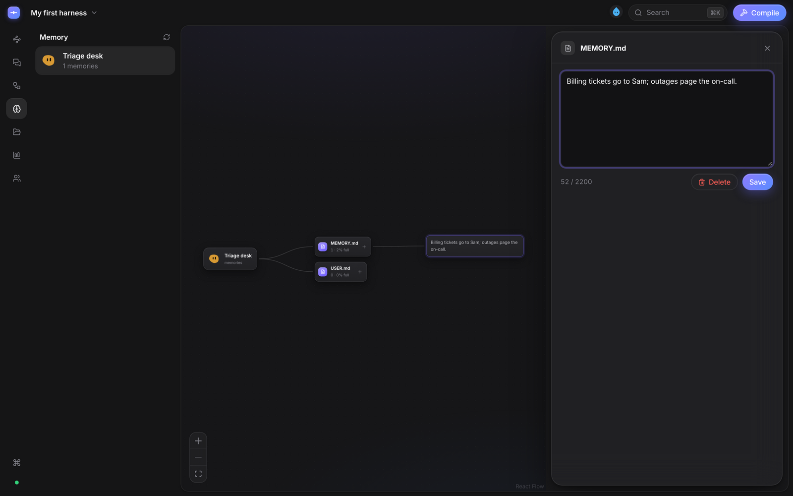
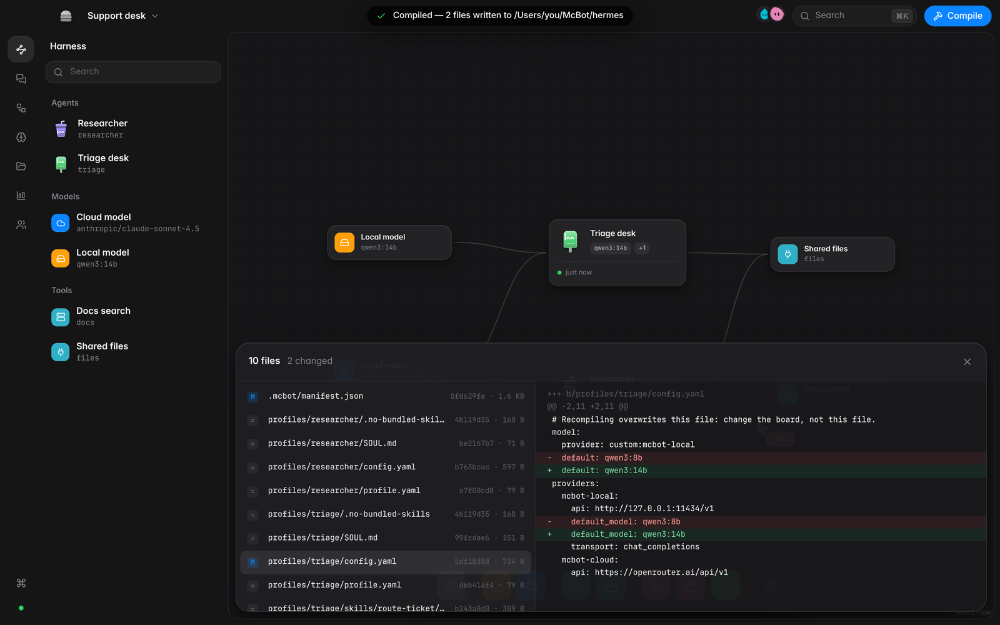
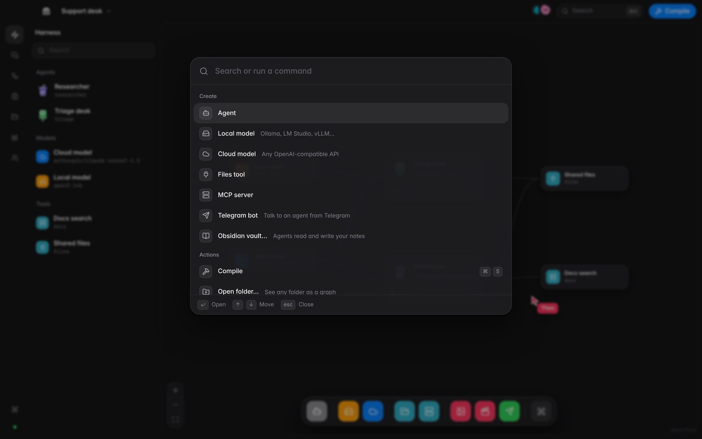

# McBot

**Draw your AI agent harness. Compile it into a real one.**

McBot is a desktop app (macOS and Windows) where a team draws a harness of AI
agents as a graph — agents, the models they think with, the tools they can use —
and that graph **compiles into a real, runnable [Hermes Agent](https://github.com/NousResearch/hermes-agent)
setup on disk**. Then the same graph shows what every agent is doing, what it
remembers, and what it costs — live, in every window on the board.

Chat-only agent tools hide the system: you can't see which cron job runs which
agent, what it remembers, or what it spends. McBot makes the harness the thing
you look at and edit.



## What it does today

Seven views, one shared board, everything a graph:

- **Graph** — agents, models and tools on a canvas. Add from the Dock or ⌘K,
  wire them, press **Compile**: every agent becomes a real Hermes profile
  (`SOUL.md`, `config.yaml`, `profile.yaml`, `skills/<name>/SKILL.md`), and the
  Compile panel shows each file written with its SHA-256 and a diff.
- **Agents** — your agents as teammates. Message one and it runs with Hermes;
  tool calls, answer, time, tokens and cost land in the thread. Its face shows
  what it is doing: thinking while it works, happy or sad after.
- **Runs** — every run as a flow graph: prompt → tool calls → answer → cost.
  Click a step for its inputs and outputs.
- **Memory** — what each agent has learned, as a graph you can edit.
- **Files** — each agent's profile, the shared folder, or **any folder you open**,
  as a graph you expand in place.
- **Cost** — spend by agent, model and day, from Hermes' own session records.
- **Team** — who is on the board and what they are looking at.

The live **island** in the title bar shows which agent is working and for how
long; **⌘K** does everything from the keyboard; a second window (⌘N) is the
same board, live, with everyone's cursor.

| Agents | Runs |
|---|---|
|  |  |
| **Files — any folder as a graph** | **Memory** |
|  |  |
| **Compile** | **⌘K** |
|  |  |

## Quick start

Requirements: Node 22.13+ and bash (macOS, Linux, or Git Bash on Windows). For
the desktop shell, Rust and the [Tauri 2 prerequisites](https://v2.tauri.app/start/prerequisites/).
Hermes Agent comes with McBot: `hermes/` is our fork, and McBot runs it.

```bash
npm install
npm run hermes:setup # once: Hermes' Python, tools and dependencies (a few minutes)
npm run desktop      # the McBot app (starts the engine + UI for you)
# or, in a browser:
npm run dev          # engine on 127.0.0.1:4317, UI on http://localhost:5173
```

The first launch walks you through setup: who McBot is for, your company,
which agents, which model (it finds Ollama and LM Studio on its own). It ends
with a compiled team you can talk to. To build by hand instead: **Add an agent**, add a **Local model** from the Dock (defaults to Ollama
on `:11434/v1` — set the model you have pulled), drag the model onto the agent,
**Compile** (⌘S), and message the agent in **Agents**.

No model at hand? `npm run stub-llm` starts a deterministic OpenAI-compatible
server on `:11500` you can point a model node at.

Your boards, runs and compiled profiles live in `~/McBot` (`MCBOT_WORKSPACE`).
Compiled agents are ordinary Hermes profiles; run them without McBot too:

```bash
npm run hermes -- -p triage     # McBot's own Hermes on McBot's agents
```

## Website and browser demo

`site/` is the McBot website (static HTML, no build step). `npm run build:demo`
builds a browser-only McBot into `dist-demo/`: the real UI and compiler with an
in-page engine and simulated runs, for trying McBot without installing
anything. `.github/workflows/site.yml` publishes both to GitHub Pages (enable
Pages with "GitHub Actions" as the source).

## How the graph maps to Hermes

| On the board | On disk (verified against the Hermes source — see [docs/HERMES.md](docs/HERMES.md)) |
|---|---|
| agent | `profiles/<name>/` — a Hermes profile, run as `hermes -p <name>` |
| agent identity | `SOUL.md` at the profile root; `profile.yaml` |
| skill | `skills/<name>/SKILL.md` with Hermes frontmatter |
| model (primary) | `config.yaml` → `model:` + `providers.mcbot-<name>` |
| model (fallbacks) | `config.yaml` → `fallback_providers:` |
| tool | `config.yaml` → `mcp_servers.<name>` (stdio command or URL) |

Two kinds of model endpoint, both OpenAI-compatible: one **local** (Ollama, LM
Studio, vLLM, llama.cpp) and one **cloud** (any OpenAI-compatible API). McBot
stores the *name* of your API-key variable, never the key.

## Architecture

```
┌──────────── McBot window ────────────┐    ┌──────────── McBot window ────────────┐
│ React · React Flow · Yjs · zustand   │    │          (second window, ⌘N)         │
└───────────────┬──────────────────────┘    └──────────────────┬───────────────────┘
                │  HTTP + WebSocket (loopback)                 │
         ┌──────┴──────────────────────────────────────────────┴──────┐
         │ McBot engine (Node)                                        │
         │  board relay (Yjs) · compiler writer · Hermes runner · data│
         └──────┬───────────────────────────────┬─────────────────────┘
                │ writes                        │ spawns, reads
        ~/McBot/hermes/profiles/<agent>/   hermes -p <agent> chat … --format stream-json
                                           state.db · memories/
```

The three contracts — graph schema, compile output layout, run event shape —
are in [`src/contracts/`](src/contracts) and described in [docs/BUILD.md](docs/BUILD.md).

## Development

```bash
npm test                               # unit, golden byte-level compiler tests, engine integration
MCBOT_HERMES_BIN=$(which hermes) npm test   # + a real Hermes run end to end
npm run typecheck
```

Read [CLAUDE.md](CLAUDE.md) before changing the compiler: it holds the
invariants (never invent a Hermes key; every compiler module is byte-tested).

## Status

v0.1, milestones M0–M4: graph, compiler, shared board, run + observe, memory and
cost. No auth (the engine only listens on loopback and checks origins), no
cloud, no installers yet. Next node kinds: workflow, file/folder, memory, human
gate, schedule.

## Licences and credits

McBot is free and open source under the [MIT licence](LICENSE). What other
projects' code may come into McBot, and why, is in [docs/MERGE.md](docs/MERGE.md).

McBot's dependencies are permissively licensed: React, React Flow, Yjs,
y-websocket, y-protocols, lib0, zod, zustand, ws, @noble/hashes,
[Blobatar](https://github.com/Alain00/blobatar) (MIT); yaml, lucide-react (ISC);
diff (BSD-3-Clause); [Paper Shaders](https://github.com/paper-design/shaders),
Tauri (Apache-2.0 / MIT); Inter (OFL-1.1). Hermes Agent is MIT (© Nous Research);
`hermes/` is our fork of it, with McBot's changes listed in [hermes/MCBOT.md](hermes/MCBOT.md).

The look takes its cues from OpenBot and Vorssaint. Only OpenBot code from
v0.1.11 or earlier (Apache-2.0) may be used; later OpenBot versions are
PolyForm Noncommercial, and Vorssaint is GPL-3.0 with a trademark policy
covering its trade dress.
