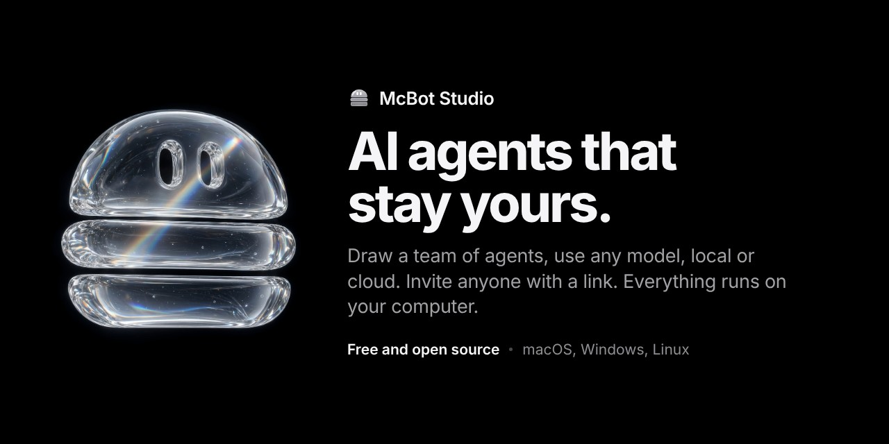
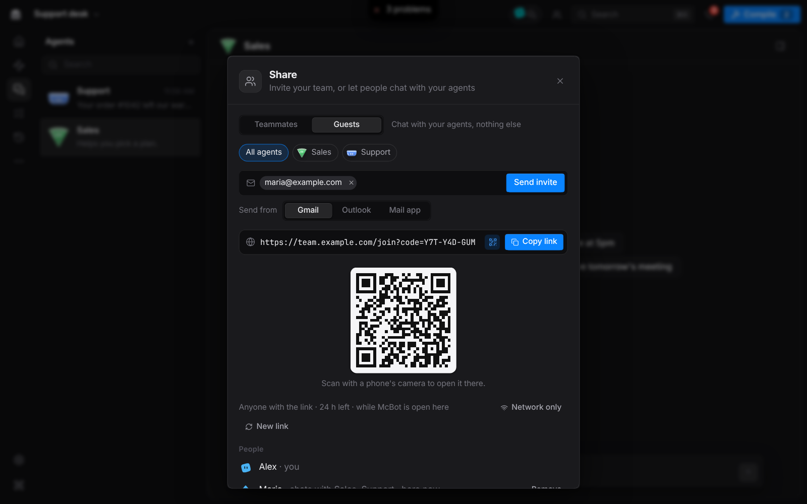
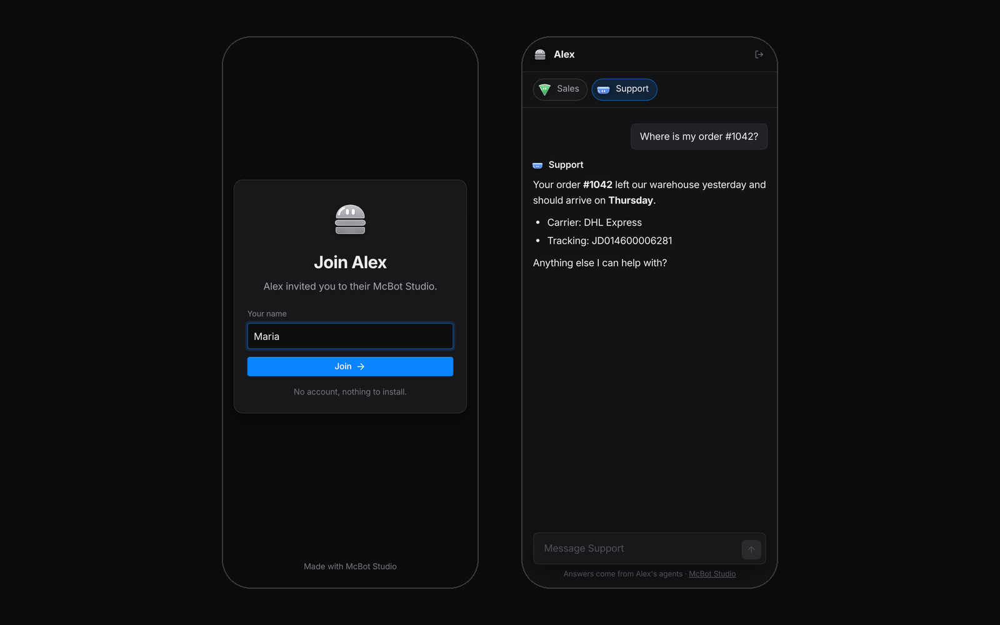
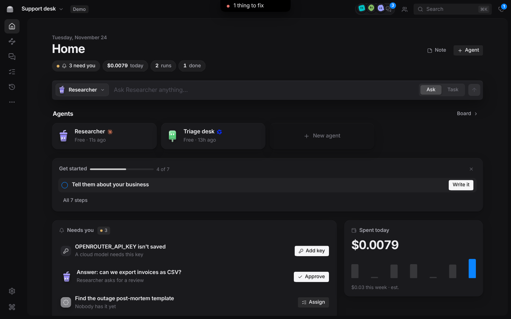
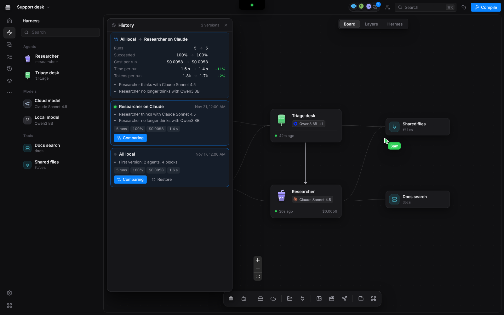
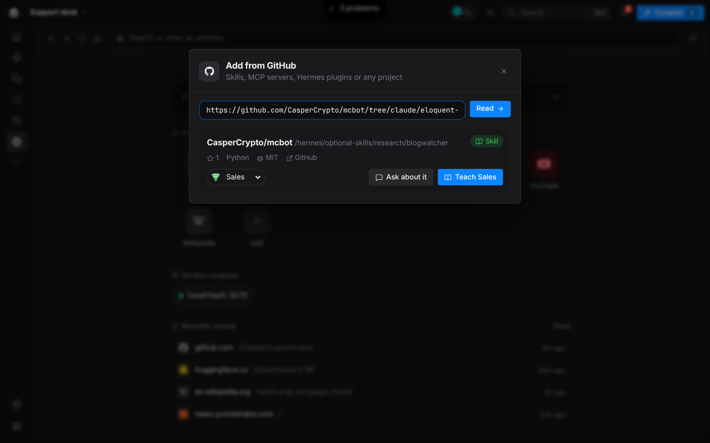
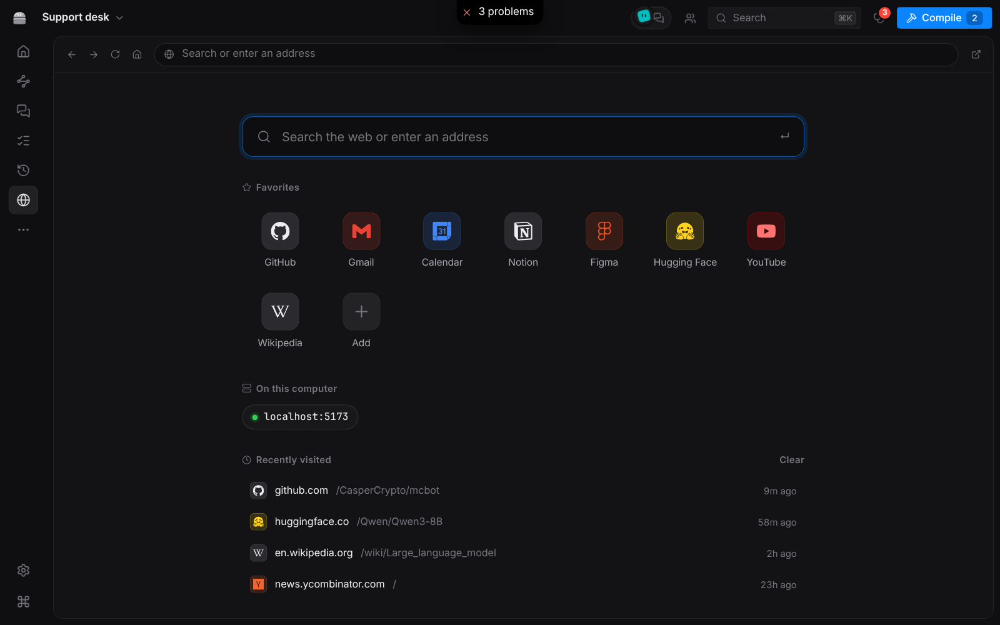
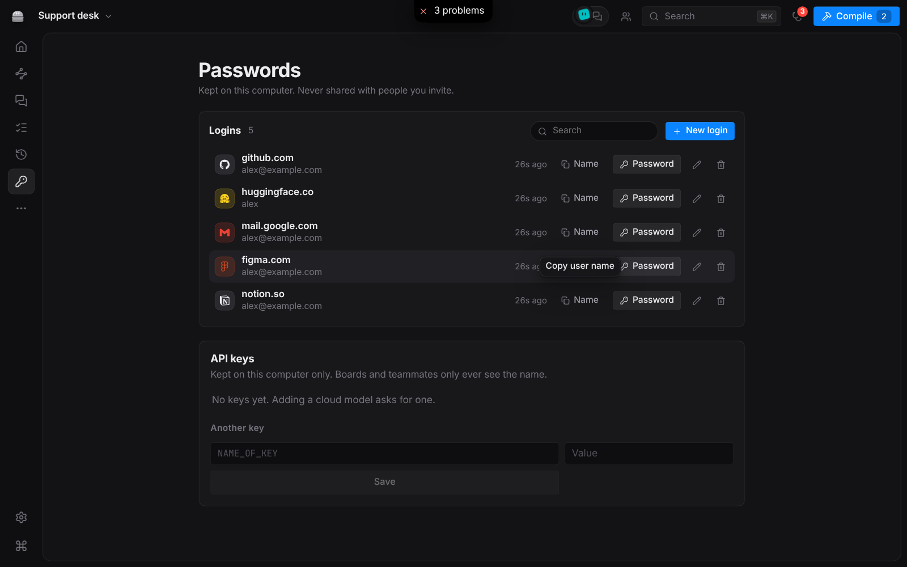
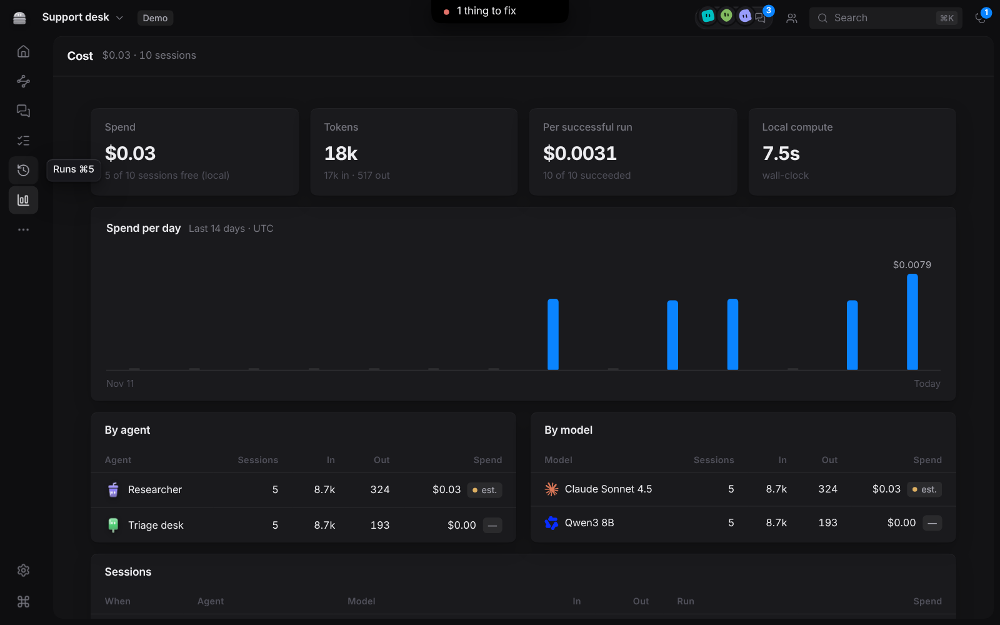

<div align="center">



# McBot Studio

**AI agents that stay yours.**<br>
Draw a team of AI agents, give them any model, and see exactly how each one works.<br>
It all runs on your computer, and the whole setup is plain files you own.

[](https://github.com/CasperCrypto/mcbot/releases/latest)
[](https://github.com/CasperCrypto/mcbot/releases)
[](https://github.com/CasperCrypto/mcbot/actions/workflows/ci.yml)
[](LICENSE)
[](https://github.com/CasperCrypto/mcbot/stargazers)

**[Download](https://github.com/CasperCrypto/mcbot/releases/latest)** · **[Try it in your browser](https://mcbot.studio/demo/)** · [Website](https://mcbot.studio) · [How it works](#how-it-works)

macOS (Apple silicon and Intel) · Windows 10 and 11 · Linux

</div>

---

## Why McBot Studio

- **Yours.** Agents, their memory, chats, files and keys stay on your computer. Use a local model and nothing
  leaves it at all.
- **Any model, any time.** Ollama, LM Studio, llama.cpp, vLLM, Jan, or any OpenAI-compatible cloud (OpenRouter,
  OpenAI, Anthropic, Gemini, Groq, DeepSeek, Mistral…). A better model comes out? Switch in one click. Your agents
  keep their personality, memory, skills and tools. No new app, no lost history.
- **The harness you can see.** Most AI apps hide how an agent works. Here it's a board: agents, models, tools,
  chat apps, skills, schedules and budgets, wired together. Press **Compile** and the board becomes a real,
  runnable agent setup on disk ([Hermes Agent](https://github.com/NousResearch/hermes-agent), included). The same
  board then shows what each agent does, remembers and costs.


## Install in a minute

**macOS or Linux**, from Terminal (no security prompt, talks only to github.com):

```bash
curl -fsSL https://mcbot.studio/install.sh | sh
```

**Or download the installer** for your computer from the
[latest release](https://github.com/CasperCrypto/mcbot/releases/latest): `.dmg` for macOS, `.exe` / `.msi` for
Windows, `.AppImage` / `.deb` / `.rpm` for Linux. Everything is inside. The first launch prepares the agent engine
by itself (a few minutes) and walks you through setup. It finds models already on your computer.

> The installers aren't code-signed yet (free and open source), so your computer asks once. On **macOS**:
> open it, then System Settings → Privacy & Security → **Open Anyway**. On **Windows**: More info → **Run anyway**.

## What you can do

### Describe a team, get a team
Tell **Ask McBot** what you need ("a support team that answers customers on Slack from our docs"). It proposes the
agents, their tools, chat apps, skills and hand-offs. Review it, add it, and one ⌘Z takes it back. Or start from
one of 8 ready-made teams or 19 starter agents.

### Invite anyone, like a shared document
Send a link by email, or show a QR code. It works from anywhere and opens in any browser, phone included:
nothing to install, no account.

- **Teammates** edit and run your agents with you, live.
- **Guests**, such as your customers, get a chat with just the agents you pick, and see only their own
  conversations.

Agents run on your computer, with your keys.

| Share: teammates or guests | A customer on their phone |
|---|---|
|  |  |

### Know which setup works better
Every compile that changes the harness is kept in **History**, with what changed in plain words and how its runs
went: success, cost, time and tokens per run. Compare two versions side by side, keep the better one, restore
any in a click.

### Everything an agent needs
- **Tools**: any MCP server, GitHub, web search out of the box, and 60+ vetted connectors. A tool can offer only
  the few functions an agent needs, so every message costs less.
- **Chat apps**: Telegram, Slack, Discord, WhatsApp and every other platform the engine ships, one bot per agent.
- **Skills**: what each agent taught itself, 44 built-in skills, a library of 140+ with suggestions that fit each
  agent, and any skill on GitHub.
- **Safety rails**: risky commands stop and ask you, Stop always works within seconds, and a daily budget
  stops spending at the limit.

### A browser, Passwords and GitHub, built in
- **Browser**: a start page with your favorites, and one-click Summarize, Key facts or Translate for any page.
- **Passwords**: your logins, sealed on your computer and filled only on their own site, next to your API keys.
- **Add from GitHub**: paste any GitHub link. A skill, an MCP server or a Hermes plugin goes straight to an
  agent; any other project downloads for your agents to work on.

| Home | History: compare two versions |
|---|---|
|  |  |
| **An agent's page, beside its chat** | **Add from GitHub** |
|  |  |
| **The browser's start page** | **Passwords** |
|  |  |
| **Runs: every step on screen** | **Cost and budgets** |
|  |  |

And: **Home** with your agents as live tiles, **Tasks** and **schedules**, **Memory** you can read and edit,
**Files** and **Code** (editor and terminal), a calm dark design with your accent colour, ⌘K for everything,
⌘⇧Space from any app, and a menu bar icon with notifications.

## How it compares

|  | McBot Studio | Chat apps (ChatGPT, Claude, Gemini) | Agent frameworks (code) |
|---|---|---|---|
| Runs on your computer | ✅ | ❌ their servers | ✅ |
| Any model, local or cloud, switched in a click | ✅ | ❌ their own | ✅ in code |
| No code needed | ✅ | ✅ | ❌ |
| See and edit how every agent works | ✅ a board, and plain files | ❌ | ✅ in code |
| Teammates and customers by link | ✅ free | team plans | build it yourself |
| Free and open source | ✅ MIT | ❌ subscription | mostly |

## How it works

| On the board | On disk (verified against the engine source, see [docs/HERMES.md](docs/HERMES.md)) |
|---|---|
| agent | `profiles/<name>/`, an agent profile |
| agent identity | `SOUL.md` at the profile root; `profile.yaml` |
| skill | `skills/<name>/SKILL.md` with skill frontmatter |
| model (primary) | `config.yaml` → `model:` + `providers.mcbot-<name>` |
| model (fallbacks) | `config.yaml` → `fallback_providers:` |
| thinking | `config.yaml` → `agent.reasoning_effort` |
| tool | `config.yaml` → `mcp_servers.<name>` (stdio command or URL; `tools.include` for only some) |
| agent abilities | `config.yaml` → `platform_toolsets` (left out = the engine's defaults) |
| image / video maker | `config.yaml` → `image_gen` / `video_gen` `{ provider, model }` |
| chat app (Telegram, Slack, Discord, WhatsApp…) | its keys, settings and who may message it in the agent's `.env`, under the platform's own variables |

Two kinds of model endpoint, both OpenAI-compatible: one **local** (Ollama, LM Studio, vLLM, llama.cpp) and one
**cloud** (any OpenAI-compatible API). Boards and compiled files carry only the *name* of a key. Keys you type
into McBot stay on your computer (owner-only), and right before a run McBot hands an agent only the keys that
agent uses, in its own profile's `.env`.

```
┌──────────── McBot window ────────────┐    ┌──── a teammate's window, or a guest's ────┐
│ React · React Flow · Yjs · zustand   │    │   any browser, through your invite link   │
└───────────────┬──────────────────────┘    └──────────────────┬────────────────────────┘
                │  HTTP + WebSocket (this computer)             │  https (Share)
         ┌──────┴───────────────────────────────────────────────┴──────┐
         │ McBot engine (Node)                                          │
         │  board relay (Yjs) · compiler · agent runner · data · share  │
         └──────┬───────────────────────────────┬───────────────────────┘
                │ writes                        │ runs (the engine's runs API), reads
        ~/McBot/hermes/profiles/<agent>/   gateway: POST /p/<agent>/v1/runs, SSE events
                                           state.db · memories/
```

The three contracts (graph schema, compile output layout, run event shape) are in
[`src/contracts/`](src/contracts) and described in [docs/BUILD.md](docs/BUILD.md).

## Build from source

Requirements: Node 22.13+ and bash (macOS, Linux, or Git Bash on Windows). For the desktop shell, Rust and the
[Tauri 2 prerequisites](https://v2.tauri.app/start/prerequisites/). The engine is in this repository; there's
nothing else to install.

```bash
npm install
npm run engine:setup # once: the engine's Python, tools and dependencies (a few minutes)
npm run desktop      # the McBot app (starts the engine and the UI for you)
# or, in a browser:
npm run dev          # engine on 127.0.0.1:4317, UI on http://localhost:5173
```

No model at hand? `npm run stub-llm` starts a deterministic OpenAI-compatible server on `:11500` you can point a
model block at. Your boards, runs and compiled agents live in `~/McBot` (`MCBOT_WORKSPACE`); compiled agents are
plain folders you can also talk to from a terminal: `npm run cli -- -p triage`.

```bash
npm test             # unit, byte-level compiler tests, engine integration
npm run typecheck
npx tauri build      # the installer for this computer
```

`site/` is the website ([mcbot.studio](https://mcbot.studio), static HTML) and `npm run build:demo` builds the
browser demo; `.github/workflows/site.yml` publishes both to GitHub Pages. Pushing a `v*` tag (or running
`release.yml` by hand) builds installers for macOS, Windows and Linux into a draft release.

## Contributing

Contributions are welcome: bug reports, ideas, docs, code. Start with [CONTRIBUTING.md](CONTRIBUTING.md); read
[CLAUDE.md](CLAUDE.md) before changing the compiler (it holds the invariants: never invent an engine config key,
every compiler module is byte-tested). Found a security issue? Please report it privately, as
[SECURITY.md](SECURITY.md) explains. The roadmap is in [docs/PLAN.md](docs/PLAN.md), the strategy in
[docs/STRATEGY.md](docs/STRATEGY.md).

**If McBot Studio is useful to you, a ⭐ on GitHub helps other people find it.**

## Licences and credits

McBot Studio is free and open source under the [MIT licence](LICENSE). What other projects' code may come into
McBot, and why, is in [docs/MERGE.md](docs/MERGE.md).

The agent engine is [Hermes Agent](https://github.com/NousResearch/hermes-agent) by Nous Research (MIT), forked
in `hermes/`. McBot's dependencies are permissively licensed: React, React Flow, Yjs, y-websocket, y-protocols,
lib0, zod, zustand, ws, @noble/hashes, qrcode-generator, [Blobatar](https://github.com/Alain00/blobatar) (MIT);
yaml, lucide-react (ISC); diff (BSD-3-Clause); Tauri (Apache-2.0 / MIT); Inter (OFL-1.1); Excalidraw (MIT). Brand
marks come from [Simple Icons](https://simpleicons.org) (CC0) and model marks from
[LobeHub's icons](https://github.com/lobehub/lobe-icons) (MIT); brand names and logos are trademarks of their
owners. Code that came from other open-source projects keeps its original licence file next to it, as those
licences require.
