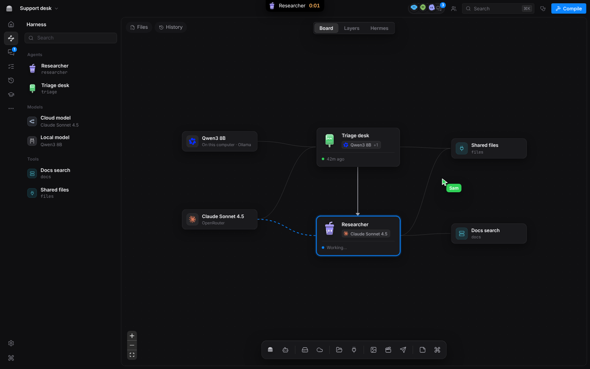
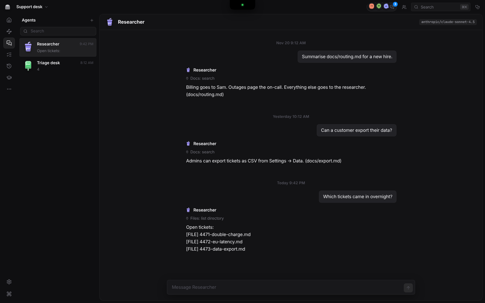
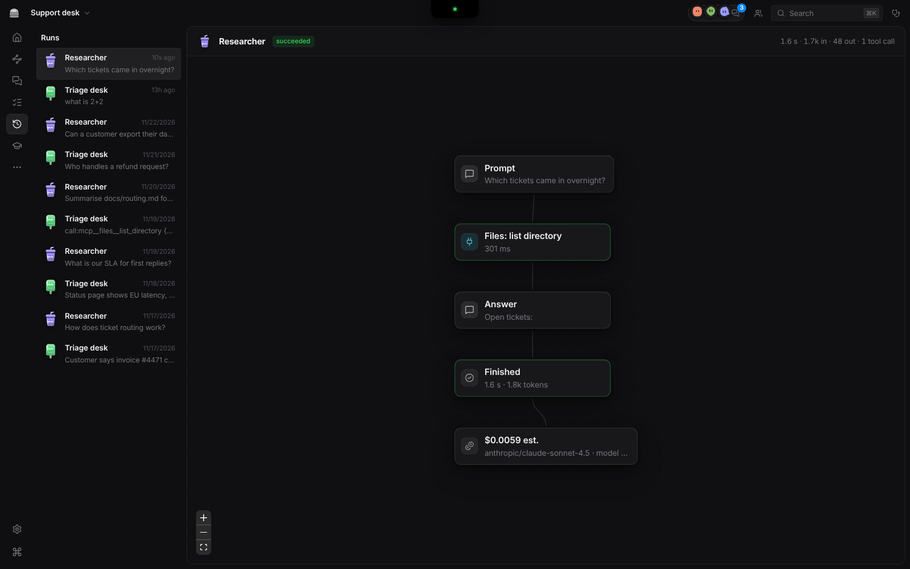
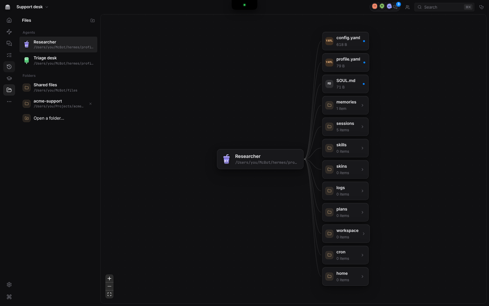
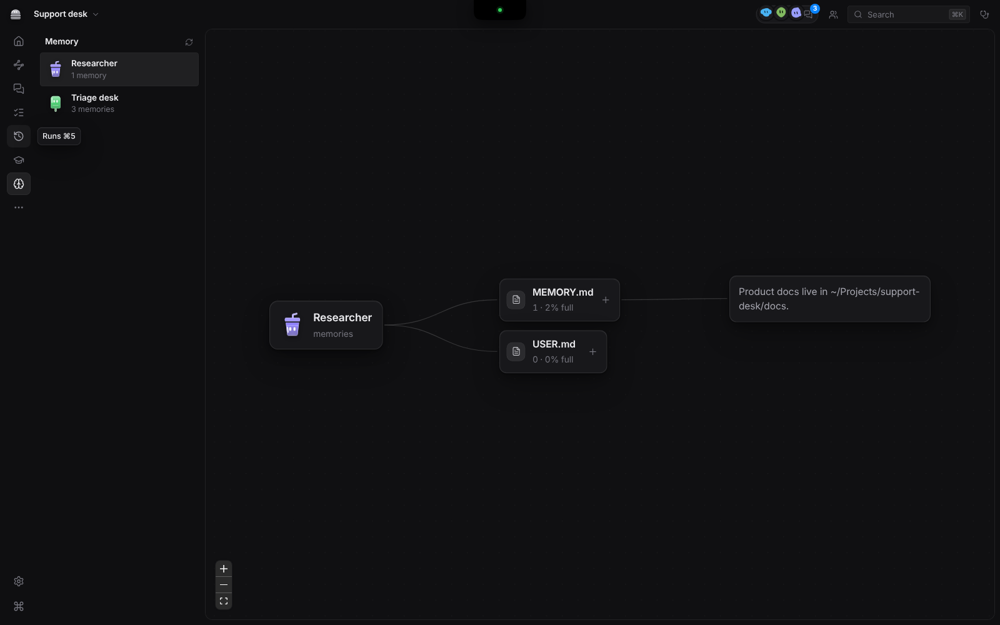
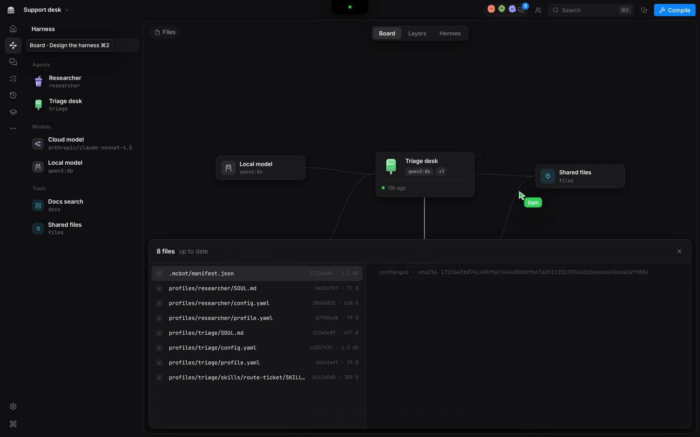
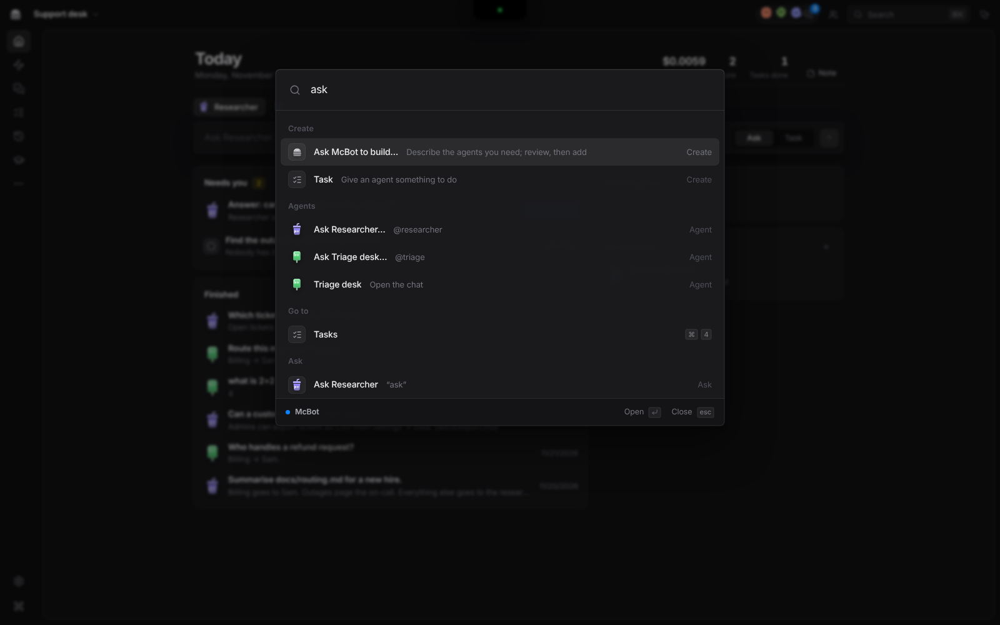

# McBot Studio

**Draw your AI team. Get real files. Watch it work.**

[mcbot.studio](https://mcbot.studio) · [Try it in your browser](https://mcbot.studio/demo/) · [Download](https://github.com/CasperCrypto/mcbot/releases/latest)

McBot Studio is a free, open-source desktop app (macOS, Windows, Linux) for designing a team
of AI agents the way an architect designs a building: agents, the models they think with, the
tools and chat apps they use, their skills and budgets, drawn as one board. Press **Compile**
and the board becomes a **real agent setup on disk** (Hermes Agent profiles: `SOUL.md`,
`config.yaml`, skills) that runs on your computer. The same board then shows what every agent
is doing, what it learned, what it remembers and what it costs.

Chat apps hide the system: you can't see which schedule runs which agent, what it remembers,
what it taught itself or what it spends. McBot Studio makes the harness the thing you look at,
edit and own, as plain files.



## What it does today (0.4)

- **Board**: agents, local and cloud models (main + backups), tools (any MCP server, plus the engine's vetted connectors),
  image and video makers, chat apps (Telegram, Slack, Discord… every platform the engine ships),
  sticky notes. Wire them, press **Compile** (⌘S). A second view, **Hermes**, draws the whole
  engine behind the board.
- **Agents**: message an agent; tool calls, answer, time, tokens and cost land in the thread.
  Risky commands stop and ask you (approval cards, also in the title-bar island).
- **Skills**: per agent, what it **taught itself** during runs, its own skills, the engine's
  44 built-in skills and the 140-skill library (install, update, remove).
- **Tasks** and **schedules**: a shared task board agents pick up, and cron-style jobs.
- **Runs**: every run as a flow graph: prompt → tool calls → answer → cost.
- **Memory**, **Files**, **Code** (editor + terminal), **Browser**: what agents remember, wrote
  and built, editable in place.
- **Cost**: spend by agent, model and day, daily budgets that stop runs at the limit.
- **Team**: share a board on your network, team chat, `@agent` from chat.
- **Engine updates**: the engine (Hermes Agent, MIT) ships inside; a weekly job merges each
  new stable release, runs every test and opens a pull request, so updates arrive tested.

| Agents | Runs |
|---|---|
|  |  |
| **Files: any folder as a graph** | **Memory** |
|  |  |
| **Compile** | **⌘K** |
|  |  |

## Install

Download McBot Studio for macOS, Windows or Linux from the
[releases](https://github.com/CasperCrypto/mcbot/releases), or on a Mac or Linux:

```bash
curl -fsSL https://mcbot.studio/install.sh | sh
```
Everything is inside:
the first launch prepares its engine by itself (about 1.3 GB, a few minutes) and
walks you through setup. McBot is free and not signed, so your computer asks
once: on **macOS** open it, then System Settings → Privacy & Security → Open
Anyway; on **Windows** choose More info → Run anyway.

## Quick start (from source)

Requirements: Node 22.13+ and bash (macOS, Linux, or Git Bash on Windows). For
the desktop shell, Rust and the [Tauri 2 prerequisites](https://v2.tauri.app/start/prerequisites/).
The engine comes with McBot, in this repository: nothing else to install.

```bash
npm install
npm run engine:setup # once: the engine's Python, tools and dependencies (a few minutes)
npm run desktop      # the McBot app (starts the engine + UI for you)
# or, in a browser:
npm run dev          # engine on 127.0.0.1:4317, UI on http://localhost:5173
```

The first launch walks you through setup: who McBot is for, your company,
which agents, which model (it finds Ollama and LM Studio on its own). It ends
with a compiled team you can talk to. To build by hand instead: **Add an agent**, add a **Local model** from the Dock (defaults to Ollama
on `:11434/v1` — set the model you have pulled), drag the model onto the agent,
**Compile** (⌘S), and message the agent in **Agents**.

No model at hand? `npm run stub-llm` starts a deterministic OpenAI-compatible
server on `:11500` you can point a model node at.

Your boards, runs and compiled profiles live in `~/McBot` (`MCBOT_WORKSPACE`).
Compiled agents are plain folders; talk to one from a terminal too:

```bash
npm run cli -- -p triage     # the triage agent, in a terminal
```

## Building the installers

`npx tauri build` makes the installer for the computer it runs on: it builds the
UI, the engine as one program (`scripts/build-engine.mjs`) and a clean copy of
the engine (`scripts/stage-hermes.mjs`), then bundles them. Pushing a `v*` tag
runs `.github/workflows/release.yml`, which builds macOS (Apple silicon and
Intel), Windows and Linux installers into a draft GitHub release.

## Website and browser demo

`site/` is the website at [mcbot.studio](https://mcbot.studio) (static HTML, no build step). `npm run build:demo`
builds a browser-only McBot into `dist-demo/`: the real UI and compiler with an
in-page engine and simulated runs, for trying McBot without installing
anything. `.github/workflows/site.yml` publishes both to GitHub Pages (enable
Pages with "GitHub Actions" as the source).

## How the graph maps to files

| On the board | On disk (verified against the engine source — see [docs/HERMES.md](docs/HERMES.md)) |
|---|---|
| agent | `profiles/<name>/` — an agent profile |
| agent identity | `SOUL.md` at the profile root; `profile.yaml` |
| skill | `skills/<name>/SKILL.md` with skill frontmatter |
| model (primary) | `config.yaml` → `model:` + `providers.mcbot-<name>` |
| model (fallbacks) | `config.yaml` → `fallback_providers:` |
| tool | `config.yaml` → `mcp_servers.<name>` (stdio command or URL) |
| agent abilities | `config.yaml` → `platform_toolsets.cli` (left out = the engine's defaults) |
| image / video maker | `config.yaml` → `image_gen` / `video_gen` `{ provider, model }` |
| Telegram bot | its token and allowed users in the agent's `.env`; an own Bot API server in `config.yaml` → `platforms.telegram` |

Two kinds of model endpoint, both OpenAI-compatible: one **local** (Ollama, LM
Studio, vLLM, llama.cpp) and one **cloud** (any OpenAI-compatible API). Boards and
compiled files carry only the *name* of a key. Keys you type into McBot stay on
your computer (owner-only), and right before a run McBot hands an agent the keys
that agent uses, in its own profile's `.env` — the only place the engine reads them.

## Architecture

```
┌──────────── McBot window ────────────┐    ┌──────────── McBot window ────────────┐
│ React · React Flow · Yjs · zustand   │    │          (second window, ⌘N)         │
└───────────────┬──────────────────────┘    └──────────────────┬───────────────────┘
                │  HTTP + WebSocket (loopback)                 │
         ┌──────┴──────────────────────────────────────────────┴──────┐
         │ McBot engine (Node)                                        │
         │  board relay (Yjs) · compiler writer · agent runner  · data│
         └──────┬───────────────────────────────┬─────────────────────┘
                │ writes                        │ spawns, reads
        ~/McBot/hermes/profiles/<agent>/   agent CLI: chat … --format stream-json
                                           state.db · memories/
```

The three contracts — graph schema, compile output layout, run event shape —
are in [`src/contracts/`](src/contracts) and described in [docs/BUILD.md](docs/BUILD.md).

## Development

```bash
npm test                               # unit, golden byte-level compiler tests, engine integration
MCBOT_E2E=1 npm test                   # + real runs on McBot's engine (after npm run engine:setup)
npm run typecheck
```

Read [CLAUDE.md](CLAUDE.md) before changing the compiler: it holds the
invariants (never invent an engine config key; every compiler module is byte-tested).

## Status

v0.1. Done: graph, compiler, shared board, runs, memory and cost (M0–M4); the
setup assistant, the engine inside the app and unsigned installers for
macOS, Windows and Linux (M5). Under way (M6): abilities, image and video makers,
Obsidian and Telegram are in; WhatsApp, Slack, Discord and email, tool and
skill catalogs and the OS keychain are next. No accounts yet: the engine only
listens on this computer and checks origins. The whole plan, M6–M15, is in
[docs/PLAN.md](docs/PLAN.md); why that order, in [docs/NEXT.md](docs/NEXT.md).

## Licences and credits

McBot is free and open source under the [MIT licence](LICENSE). What other
projects' code may come into McBot, and why, is in [docs/MERGE.md](docs/MERGE.md).

McBot's dependencies are permissively licensed: React, React Flow, Yjs,
y-websocket, y-protocols, lib0, zod, zustand, ws, @noble/hashes,
[Blobatar](https://github.com/Alain00/blobatar) (MIT); yaml, lucide-react (ISC);
diff (BSD-3-Clause); Tauri (Apache-2.0 / MIT); Inter (OFL-1.1). Code that came from other open-source
projects keeps its original licence file next to it, as those licences require.
